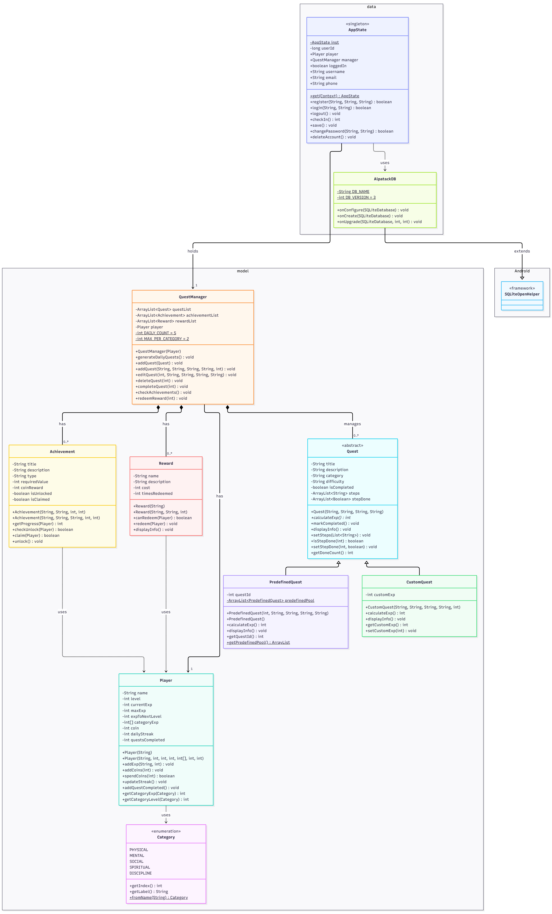

<h1 align="center">🎯 Alpatack </h1>

  A Quest-Based Personal Growth Application
   
  <i>Object-Oriented Programming Project</i>

## ┊ About This Project

Alpatack is an Android application that turns personal growth activities into quests. Players complete tasks, earn experience points and coins, track their progress, unlock achievements, and redeem rewards.

## ┊ Overview

The application organizes personal development into five categories:

- **Physical**
- **Mental**
- **Social**
- **Spiritual**
- **Discipline**

Players can complete predefined quests or create custom quests with configurable experience rewards. Quests support individual steps to help track progress.

## ┊ Features

- Player levels and experience tracking.
- Category-specific experience and levels.
- Daily quest generation.
- Custom quest creation, editing, and deletion.
- Quest step tracking and completion.
- Coins and reward redemption.
- Achievement progress, unlocking, and claiming.
- Daily streaks and check-ins.
- Account registration and login.
- SQLite database management.

## ┊ OOP Concepts Demonstrated

- **Encapsulation:** Private fields protect internal data, while public methods provide controlled access.
- **Inheritance:** `CustomQuest` and `PredefinedQuest` inherit from `Quest`; `AlpatackDB` extends Android's `SQLiteOpenHelper`.
- **Polymorphism:** Quest subclasses provide their own implementations of `calculateExp()` and `displayInfo()`.
- **Abstraction:** The abstract `Quest` class defines shared quest attributes and requires subclasses to implement experience calculation.
- **Composition:** `QuestManager` contains collections of quests, rewards, and achievements, as represented in the UML diagram.
- **Enumeration:** `Category` defines a fixed set of personal growth categories.

## ┊ Architecture

The following table summarizes the packages represented in the UML diagram.

| Package | Classes | Responsibility |
| --- | --- | --- |
| `model` | `Category`, `Player`, `QuestManager`, `Quest`, `CustomQuest`, `PredefinedQuest`, `Reward`, `Achievement` | Application models and progression logic. |
| `data` | `AppState`, `AlpatackDB` | Shared application state, account operations, and database management. |
| `Android` | `SQLiteOpenHelper` | Android framework dependency. |

## ┊ Development Requirements

- Android Studio.
- An Android SDK compatible with the project's Gradle configuration.
- A JDK compatible with the project's Android Gradle Plugin.
- An Android emulator or compatible physical Android device.

## ┊ How to Run

1. Clone or download this repository.
2. Open the Android project in Android Studio.
3. Allow Gradle to synchronize project dependencies.
4. Install any SDK components requested by Android Studio.
5. Start an emulator or connect an Android device with USB debugging enabled.
6. Select the application's run configuration and click **Run**.

> Use the SDK and JDK versions specified by the project's build configuration.

## ┊ UML Class Diagram

The diagram below shows the application's classes, attributes, methods, and relationships. Click the image to open it separately.

### Main Components

| Class | Purpose |
| --- | --- |
| `Category` | Defines the five personal growth categories. |
| `Player` | Stores progression, category experience, coins, streaks, and completed quest counts. |
| `QuestManager` | Manages quests, achievements, and reward redemption. |
| `Quest` | Defines shared quest properties and step tracking. |
| `CustomQuest` | Supports configurable experience rewards. |
| `PredefinedQuest` | Represents quests associated with a predefined pool. |
| `Reward` | Defines coin costs and redemption behavior. |
| `Achievement` | Tracks progress, unlock conditions, and claiming. |
| `AppState` | Manages shared application and account state. |
| `AlpatackDB` | Manages SQLite configuration, creation, and upgrades. |

## ┊ Learning Purpose

This project demonstrates how object-oriented programming concepts can organize an Android application into reusable models, specialized quest types, progression logic, and persistence components.
